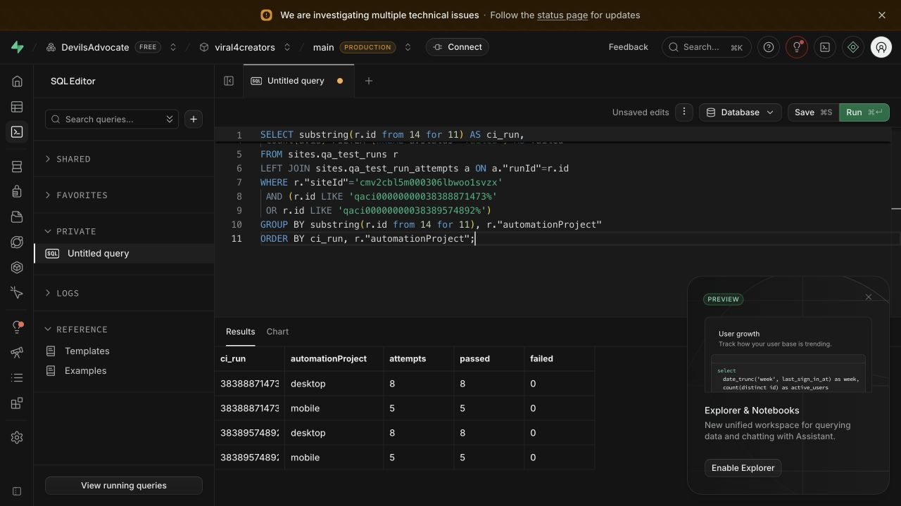

# Gemini 503 и живые голосовые проверки RU/UK — 13.10.2026

Два последовательных свежих голосовых прогона на gemini-3.1-flash-lite прошли: 38388871473 и 38389574892. Исправления опубликованы в main и assist-api production; Nova a9fc5a41 сохранён. Подробная история ошибок и приёмки ниже.

## Диагностика

До исправления ручной прогон `38382148296` повторил исходный сбой: оба голосовых кейса останавливались на `chat-seed: HTTP 502`; в серверных логах — Gemini `ApiError status=503`. Озвучка и распознавание ещё не запускались.

В начале диагностики production `assist-api` использовал защищённый `GEMINI_API_KEY` и модель `gemini-3.6-flash` по умолчанию. Ключ не раскрывался и не менялся. Из отдельного защищённого временного deployment выполнены ограниченные реальные запросы с тем же production-ключом: список моделей, обычная генерация (234 токена, STOP), потоковая генерация (202 токена). Оба запроса вернули непустой ответ. Это подтверждает работоспособность ключа в момент диагностики; не доказывает непрерывную доступность провайдера или баланс в кабинете. Покупки кредитов не выполнялись. Временные deployments удалены; диагностического маршрута в опубликованном коде нет.

## Исправление

Коммит `b252e513defdc1fb8f9e16c7bdf43f92e5af9f57`, опубликован в main и production `assist-api`.

Ранее повтор охватывал только отклонение `generateContentStream()`. SDK также может выдать 503 при чтении первого фрагмента после открытия потока. Теперь открытие и чтение до первого фрагмента используют общий предел: максимум два повтора с паузами 1 и 2 секунды, тот же ключ, модель и сигнал отмены. Общий срок ожидания первого токена остаётся 30 секунд. После выдачи любого фрагмента поток не переигрывается. Ошибки оплаты, ключа и лимита не повторяются. Модель и голос Nova `a9fc5a41` не менялись; переозвучка не запускалась.

Проверки: 10 целевых тестов, TypeScript и ESLint прошли. Тесты включают 503 при первом чтении, общий предел повторов, отмену ожидания и отсутствие повторов после начала ответа.

Google рекомендует ограниченное увеличение паузы для временных 503: [официальная документация](https://ai.google.dev/gemini-api/docs/troubleshooting).

## Живой прогон после исправления

[Ручной QA 38382991606](https://github.com/tarasenkoandriii/viral4creators/actions/runs/38382991606) — success: **13 passed, 3 skipped, 0 failed**. Оба `SBX-VOICE-RU` и `SBX-VOICE-UK` прошли без повторного запуска кейса: seed-ответ, mp3 озвучки, STT, голосовой ticket, ответ на распознанную речь. Мобильные дубли платных smoke намеренно пропускаются; UI-проверки mobile проходят.

- RU: язык STT ru, 245420 байт mp3, 25 слов эталона / 25 распознанных, 3 правки, WER 0.12.
- UK: язык STT uk, 261932 байта mp3, 28 слов эталона / 27 распознанных, 3 правки, WER 0.107142857.
- Порог в исходном тесте 0.20 не менялся. Это синтетический TTS/STT roundtrip; он не доказывает качество записи живого микрофона, воспроизведение на устройстве или выполнение голосовых команд.
- Отчёты desktop и mobile доставлены через штатный OIDC. В production-базе подтверждены desktop 8/8 passed и mobile 5/5 passed, failed=0.
- Свежий seed-ответ в базе: 10:23:55.773 UTC, `answerPath=model`, `streamState=complete`, `gemini-3.6-flash`, 1188 входных и 712 выходных токенов, 204 символа. Отдельная запись knowledge QA использовала cache; её не выдаём за генерацию.
- Soniox observability подтверждает реальные RU TTS и STT со статусом ok и длительностью звука около 15 секунд.

[Сохранённые численные метрики](assets/qa-voice-metrics-2026-10-13.json).

Плановые ежедневные запуски остаются отдельным критерием: один или несколько ручных успехов не меняют историю ранее упавших scheduled запусков. Абсолютную доступность внешнего Gemini гарантировать нельзя; при исчерпании ограниченных повторов ошибка сохраняется, а не превращается в фиктивный ответ.

## Дополнительный сбой квоты и второй этап исправления

[Повторный прогон 38383757726](https://github.com/tarasenkoandriii/viral4creators/actions/runs/38383757726) сохранил RU success, но UK получил `chat-followup: HTTP 502` после успешных TTS/STT. Серверный журнал показал `ApiError status=429`, а не 503. Итог 12 passed / 3 skipped / 1 failed не удалялся и не заменялся успешным отчётом.

`29c3f043bf96f921e47ae231c0c21b91e941a0d3` добавляет безопасные категории quota-периода/единиц и числовой RetryInfo в приватный журнал, без сырого тела ошибки, ключа или текста запроса. Повтор 429 разрешён только при явной минутной квоте и указанном провайдером ожидании не более 10 секунд; общий лимит двух повторов и сигнал отмены остаются. Суточные, неизвестные и длинные ограничения, ошибки ключа и оплаты не повторяются. При 503 используются прежние ограниченные паузы. Модель и ключ сохраняются.

В живом голосовом QA между seed-генерацией и ответом на распознанную речь добавлено 65 секунд. Это распределение нагрузки общего проекта Gemini, а не повтор теста или замена генерации заглушкой. Таймаут кейса увеличен ровно на эту паузу: 285 → 350 секунд. Все проверки, лимит длины озвучки, WER ≤ 20%, нулевые повторы платного кейса и OIDC-доставка сохранены.

Проверки второго изменения: 21 целевой тест, TypeScript, ESLint и 12 тестов формирования/доставки QA-отчёта прошли. Предыдущий полный CI `38382762753` также success.

После публикации `29c3f04` новый отдельный вопрос подтверждён в production-базе: `7fd3f4aa-98e9-4bcd-8f98-0ae325b9b88e`, 10:44:51.163 UTC, model/complete, `gemini-3.6-flash`, 1185 входных / 704 выходных токена, 312 символов в журнале. Это свежая генерация, не FAQ/cache/refusal.

## Приёмка версии с обработкой квоты

[38385527294](https://github.com/tarasenkoandriii/viral4creators/actions/runs/38385527294) на `29c3f04` — success, 13 passed / 3 skipped / 0 failed. RU прошёл за 1.3 минуты, UK за 2.6 минуты с предусмотренными паузами. WER остался 0.12 / 0.107142857; порог 0.20 сохранён. Отчёты доставлены; production-база подтверждает desktop 8/8 и mobile 5/5, ошибок нет.

Контрольный повтор [38386150583](https://github.com/tarasenkoandriii/viral4creators/actions/runs/38386150583) снова выявил 429 на UK chat-followup: 12 passed / 3 skipped / 1 failed. Структурированный период квоты отсутствовал; дополнительный повтор такой ошибки не выполнялся. Полный CI версии 29c3f04 прошёл.

## Настройка доступной модели и устранение ложного успеха через cache

Тем же production-ключом gemini-3.6-flash вернул 429, а gemini-3.1-flash-lite успешно сгенерировал украинский ответ. Безопасная диагностика не подтвердила конкретный период квоты или идентификатор billing-проекта. Для production assist-api установлен GEMINI_MODEL=gemini-3.1-flash-lite; другие приложения сохраняют свои настройки. Ключ не заменяли, платежи не выполняли. Голос Nova a9fc5a41 неизменен, массовая переозвучка не запускалась.

Коммит 61e46d1 добавил точный учёт стоимости Flash-Lite: за миллион токенов input $0.25, audio input $0.50, cached input $0.025, cached audio $0.05, output $1.50 ([официальный прайс](https://ai.google.dev/gemini-api/docs/pricing)). 84 целевых теста, проверки типов и lint прошли. В голосовых кейсах передаётся QA-контекст, который отключает семантический cache: каждый seed и followup теперь требует свежего модельного ответа. Порог WER и проверки отказов сохранены.

Production deployment: assist-9usxerl7k-sibionics-ai.vercel.app, исходники 61e46d1. После продвижения health подтверждает database=up. Итоги свежих контрольных прогонов добавляются ниже.

### Свежий прогон Flash-Lite

[38388871473](https://github.com/tarasenkoandriii/viral4creators/actions/runs/38388871473), исходники 61e46d1 — success, 13 passed / 3 skipped / 0 failed. RU: 18 эталонных / 17 распознанных слов, 1 правка, WER 0.055556. UK: 21 / 20 слов, 1 правка, WER 0.047619. Порог 0.20 неизменен; попытка каждого кейса — 0, без тестовых повторов.

В production-журнале подтверждены четыре voice-ответа gemini-3.1-flash-lite, model/complete с ненулевыми токенами: 11:15:28.458 UTC (1217/55), 11:16:58.069 (1230/110), 11:18:14.005 (1223/75), 11:19:45.688 (1252/150). Отдельный SBX-AI использовал cache и не считается свежей модельной проверкой. Физические iOS/Android кейсы остаются not-run: синтетический smoke не заменяет их.

### Последовательный контрольный повтор

[38389574892](https://github.com/tarasenkoandriii/viral4creators/actions/runs/38389574892) на тех же исходниках 61e46d1 — success, 13 passed / 3 skipped / 0 failed. RU и UK: по 24 эталонных / 23 распознанных слова, по одной правке, WER 0.041667. Оба прогона выполнены последовательно, без повторов упавшего кейса и без семантического кэша voice-ответов. Production-база подтверждает четыре отчёта: desktop 8/8 и mobile 5/5 для каждого CI run, failed=0. Снимок выше обновлён на эти два финальных прогона.

Полный CI 38387804680 прошёл кодовые тесты, но обнаружил устаревшие счётчики документации (10261 вместо 10262). Коммит fff4cc4 исправляет четыре счётчика; [повторный CI 38389613048](https://github.com/tarasenkoandriii/viral4creators/actions/runs/38389613048) — success: исправленная документация, backend, sites-backend, frontend, assist и widget прошли проверки. Это расхождение не скрывалось повтором прежнего CI.

Повторная production-сверка: четыре voice-ответа 11:21:26.038 / 11:23:00.166 / 11:24:15.882 / 11:25:49.853 UTC — model/complete, gemini-3.1-flash-lite, токены соответственно 1217/97, 1242/98, 1223/80, 1256/135. HTTP success дополнен проверкой фактической генерации.
