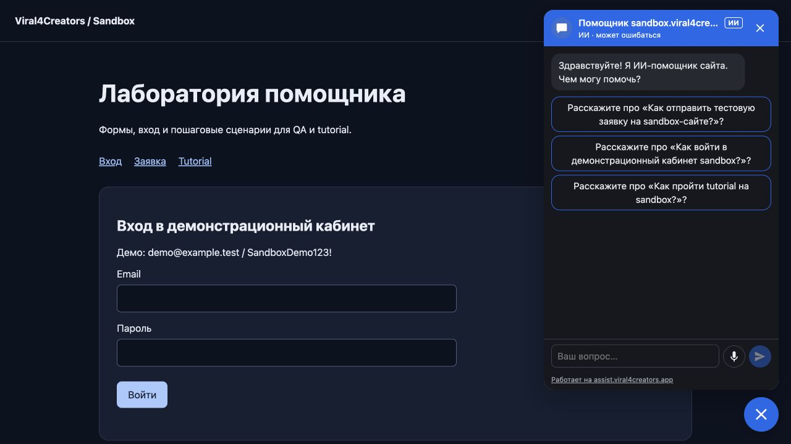

# Сквозной аудит QA и AI helper — 13 октября 2026

## Границы проверки

Проверены код QA-каталога, фиксация версий кейсов, импорт отчётов Playwright, привязка GitHub OIDC к репозиторию/сайту/аккаунту, доступный журнал production, последние реальные GitHub scheduled-запуски, индексация источников знаний и составные кроны аналитики. Production-база исследована запросами только для чтения. Живой запрос выполнен на собственном sandbox с коротким синтетическим текстом.

## Фактическое состояние до исправлений

- `/health`: база доступна, API стартует.
- Живой sandbox: session HTTP 200, chat HTTP 502 `UPSTREAM`; requestId `e9056b74-3171-4673-8530-56bb6c1225d9`. Работоспособность всего помощника из health не следует.
- Последний scheduled [38271786980](https://github.com/tarasenkoandriii/viral4creators/actions/runs/38271786980), 12 октября 15:39 UTC: 11 passed, 3 skipped, 2 failed. `SBX-VOICE-RU` и `SBX-VOICE-UK` падают на chat-seed HTTP 502 до TTS/STT.
- Предыдущий scheduled [38141503886](https://github.com/tarasenkoandriii/viral4creators/actions/runs/38141503886), 11 октября 13:01 UTC: failure. В просмотренных 30 запусках оба scheduled красные; успешные ручные/PR-запуски не доказывают стабильность расписания.
- Расписание объявлено 06:17 UTC, фактические старты существенно позже. Время GitHub schedule нельзя обещать клиенту как точное.
- В QA: 9 кейсов, 10 запусков; за последние 7 дней автоматические попытки: 52 passed, 4 failed, 4 skipped; ручная blocked: 1.
- Отчёт последнего scheduled доставлен: desktop сохранил 8 попыток, включая 2 failed; mobile — 5. Импорт не подменяет падения успешным результатом.
- Сообщения за неделю: visitor complete 59; assistant complete 51, partial 8. Это состояния сообщений, а не оценка качества ответов.
- Источники на момент аудита: site active 2, admin active 1; site knowledge versions published 3, admin versions 0. Это не заявляется доказательством готовности административного помощника.
- Обходы: 2 done за неделю, последний 10 октября 12:30 UTC. Пустой тик крона не доказывает повторный обход всех сайтов.
- 13 октября около 09:04 UTC свежие crawl/embed/admin-embed/handoff замки завершены; analytics/budget/billing завершены около 09:00 UTC. Daily retention/rollup/digest/learn тоже имеют завершения. Таблица замков хранит последнее состояние, не полную историю.
- `assist-admin-analytics` и daily lock намеренно не освобождаются: это cooldown, что подтверждено кодом. `lastFinishedAt=NULL` для них не объявляется зависанием.

## Исправления

1. Составные кроны теперь сохраняют `PartialFailure` в `lastError`, когда файлы, индексация или явно завершившийся ошибкой этап аналитики не выполнены. Остальные этапы продолжаются.
2. Site/Admin индексаторы возвращают число неудачных сайтов и ошибок уборки старых сборок. Эти ошибки больше не исчезают из результата общего тика.
3. Обработка источников возвращает отдельный `failed`; счётчик охватывает неудачный разбор и исчерпанные попытки. Повторные попытки и существующие leases сохранены.
4. Диагностика недоступности chat-модели добавляет только числовой HTTP статус провайдера. Ключи, промпты и сырой ответ SDK не журналируются этой диагностикой.

5. Live QA больше не пишет API trace с visitor token и не выводит полный ответ session/chat в assertion. Исправление `61e2a69` предотвращает новые записи; уже созданные артефакты не объявляются очищенными.
6. Открытие chat-stream допускает ровно один повтор после HTTP 503 с задержкой 500 мс и тем же abort signal. После начала выдачи текста повтор невозможен; 401/402/429 не повторяются. Модель не меняется.

7. В браузере подтверждена готовность публичного виджета, но его footer вёл на `.invalid`. Исправлена ссылка на действующий `assist.viral4creators.app` (HTTP 200 после перехода на /en). Origin-заглушки, которые должны переопределяться настройкой, не подменялись.

Коммит учёта cron и диагностики: `a25af59`. Голос Nova `a9fc5a41` не менялся, переозвучка не запускалась. Схема базы не менялась.

## Проверка QA-потока и границы

GitHub OIDC требует привязки account/site/repository ID/owner ID/workflow; при неполной конфигурации отказывает. Импорт сверяет SHA подписанного запуска, версии активных кейсов и сохраняет фиксированные версии запуска. Повторная доставка защищена хешем отчёта и revision/CAS. Эти механизмы не ослаблялись.

UI выводит runnerStatus и SHA источника/деплоя из provenance автоматической попытки. `complete` означает выполнение всех кейсов, а не отсутствие ошибок; смотреть также passed/failed и runnerStatus. Skipped не засчитываются как успешное выполнение.

Проверка актуальной авторизованной клиентской сессии не выполнена: доступный frontend просит вход. Изоляция клиентов проверяется CI на тестовой базе, а не изменением production-прав.

## Проверки кода

- Проверка типов и ESLint прошли на установленном lockfile.
- Ранее целевые QA/cron suites: 108 тестов, 12 suites прошли.
- После расширения обработки источников: 16 тестов, 6 suites прошли.
- Chat/model/stream/config: 27 passed, 1 skipped, 4 suites прошли. Пропуск не считается проверкой.
- Retry: 8 тестов прошли, типы/линтер прошли. Reporter/delivery: 12 тестов прошли.
- Полный [CI 38376744284](https://github.com/tarasenkoandriii/viral4creators/actions/runs/38376744284) на `1bd29de`: success; sites-backend 3755 passed, 3 skipped, 343 suites passed, 1 suite skipped; assist checks success.
- Дополнительная проверка вложенных ошибок cron: 7 passed; brand: 10 passed. Типы, ESLint, синхронизация 57 общих модулей и граф разделения Site/Admin прошли.

## Оставшиеся критерии приёмки

- Устранить подтверждённую причину upstream 502 и получить ответ на реальном sandbox.
- После этого получить зелёный RU/UK voice QA с доставленным отчётом.
- Отдельно подтвердить серию последующих scheduled-запусков: один ручной зелёный прогон не заменяет ежедневную историю.
- Сохранять историю каждого cron-запуска (этапы, длительность, отказ/пропуск), если нужна историческая надёжность, а не последнее состояние замка.

## Диагностика нового API

Сборка `assist-bymntqey3` готова; 38 миграций, pending нет. В защищённой версии после реального запроса журнал фиксирует `ApiError status=503`: провайдер Gemini недоступен. Это подтверждает upstream-проблему; здесь нет подтверждения HTTP 402 или необходимости пополнить баланс. Проверка с JSON-протоколом также получила `UPSTREAM`, requestId `884d022c-a937-480a-8a07-a4990a2b01a2`. После этого добавлен ограниченный retry; окончательный результат проверяется на следующей сборке.

После добавления ограниченного retry сборка `assist-to9kcvbgk` вернула HTTP 200 / success/data, текст 85 символов, requestId `b8e8da47-f266-47c2-a2e7-d1cb74677568`. Последующая проверка базы установила `answerPath=refusal`, `model=NULL`, токены 0: это служебный отказ, а не успешная генерация. Первоначальная интерпретация этого ответа как восстановления модели была ошибочной; HTTP 200 и длины текста недостаточно для такой приёмки.

`npm audit --omit=dev --audit-level=high`: порог прошёл; 3 moderate advisory entries в цепочке mammoth → argparse → sprintf-js (GHSA-hp3w-g68c-fv3c). Автоматический force предлагает несовместимый откат mammoth; не применён. Требуется отдельная проверка безопасного обновления парсера DOCX, а не заявление «уязвимостей нет».

## Production и повторный QA

`1bd29de` развёрнут и promoted: `assist-to9kcvbgk`, deployment `dpl_2TGWWmgyNu82MbtCkDAAFcqouP5Q`; health на рабочем домене подтверждает database up. После переключения embed/admin-embed/crawl/handoff завершились около 09:42 UTC, lastError NULL. Это фактические последние тики, не обещание полной исторической стабильности.

[Повторный ручной QA 38378070206](https://github.com/tarasenkoandriii/viral4creators/actions/runs/38378070206): failure, 11 passed / 3 skipped / 2 failed. Оба RU/UK voice-кейса вновь остановились на chat-seed HTTP 502. В production-логе подтверждён `ApiError status=503` около 09:43:16 UTC. Ровно один повтор открытия потока не устраняет длительную недоступность провайдера. Оба desktop/mobile отчёта успешно доставлены, ошибки не скрыты. Soniox TTS/STT в этих кейсах не достигнуты; голосовую приёмку не объявлять завершённой.

### Открытый внешний блокер

Генерация новых ответов Gemini не подтверждена: полный голосовой QA вновь получил 503 через helper 502. Успешный knowledge QA использовал cache (495 символов, model=NULL, токены 0); ответ пробного запроса на 85 символов использовал refusal. В последних семи сообщениях после 09:20 UTC пять попыток model остались partial с 0 входных/выходных токенов, одна запись cache завершена и одна refusal завершена. Смена модели, ключа, тарифа или голоса не выполнялась. Для закрытия приёмки нужны восстановление доступности выбранной модели и новый зелёный RU/UK прогон, затем последующие ежедневные scheduled результаты. Нельзя заменять этот критерий успешным health или подстановкой тестового ответа.

Последний этап включает исправление публичной ссылки и учёт вложенных счётчиков failed/errors аналитики. Штатное throttling=true не классифицируется как ошибка; failed exports и явные null/error завершённых частей сохраняются.

## Финальные исправления — de9bd1f

Коммит `de9bd1f` отправлен в `main`, сборка `assist-2v4us7g9a` Ready и promoted, deployment `dpl_8RBD8NUF2zWTJhRnTEgXttmSJQZx`. Health после переключения: success, database up. В реальном браузере на собственном sandbox чат открылся, поле ввода активно, ссылка footer теперь `https://assist.viral4creators.app/?utm_source=widget&utm_medium=powered_by`.

В базе подтверждены обе записи ручного QA 38378070206: desktop — 8 попыток / 2 failed, mobile — 5 / 0 failed.

Подтверждение интерфейса:

Финальная [CI-проверка 38378756342](https://github.com/tarasenkoandriii/viral4creators/actions/runs/38378756342) на `de9bd1f`: success. Прошли серверные тесты/типы/линт/схема, assist, widget (включая Playwright), sites-landing (включая e2e, Lighthouse, axe) и assist-integrations. Полный код CI зелёный; production/provider QA остаётся красным, как описано выше.

### Разделение приёмки помощника и модели

`SBX-AI` подтверждает работу опубликованного helper API и выдачу ответа базы знаний, включая штатный cache/FAQ. Он НЕ подтверждает новый вызов Gemini. В тесте отказ уже исключается через `refused=false`; отдельный диагностический probe ошибочно не проверял этот флаг, что обнаружено при сопоставлении с production-базой. Новую LLM-генерацию подтверждать по `answerPath=model`, complete и фактическим данным вызова, а не только HTTP 200 / непустому тексту.

## Обновление 10:27 UTC: живой RU/UK прогон зелёный

Первоначальный блокер выше отражает предыдущие запуски. После `b252e51` исправлены ограниченные повторы 503 при открытии и первом чтении потока (общий предел два повтора, паузы 1 и 2 секунды; после первого фрагмента повторов нет). Ручной `38382991606` — 13 passed / 3 skipped / 0 failed; оба голосовых кейса прошли, отчёты доставлены в production QA. Свежая генерация Gemini подтверждена по model/complete и токенам. Модель, ключ и дефолт Nova не менялись. Историю scheduled запусков это не заменяет. [Диагностика, метрики и доказательства](GEMINI-VOICE-RU-UK-2026-10-13.md).

Итог следующего этапа: повтор выявил 429 у gemini-3.6-flash. Production assist-api переведён на проверенный тем же ключом gemini-3.1-flash-lite с точным учётом стоимости; голос Nova неизменен. Коммит 61e46d1 также отключает семантический cache голосовых QA через QA-контекст. Два последовательных свежих прогона 38388871473 и 38389574892 — каждый 13 passed / 3 skipped / 0 failed; production подтверждает desktop 8/8 и mobile 5/5 в обоих. WER первого RU/UK — 5.56%/4.76%, второго — 4.17%/4.17%, порог 20% не меняли. Scheduled стабильность и физические устройства остаются отдельной приёмкой.
